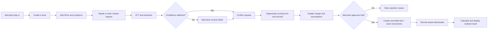

# 01 — Master implementation plan: LEAP AI

## 0. Product contract

**One-sentence product:** LEAP AI is a multilingual merchant growth operating system that captures demand which never became a transaction, combines it with authorized operational data, recommends profit-aware actions, and learns from outcomes.

**Merchant archetype:** Tamil-speaking independent kirana, drinks shop, pharmacy-like general retail (do not provide medicine recommendations), stationery store, café, salon or small multi-location retailer. Start with a kirana/beverage shop; model arbitrary product catalog thereafter.

**Operational constraints:** low-end Android, intermittent data, noisy voice, manually maintained stock, incomplete costs, fragmented payment statements, no dedicated analyst. The owner has under 2 minutes per day for logging missed requests.

**Competitive positioning:** Not "AI business insights from payments" alone; payment rails observe completed sales while LEAP builds a permissioned ledger of unmet customer intent and explicitly connects that ledger to stock, purchase cost, action approval, and measured realized profit. Existing Paytm merchant tools are complements, not claims to replace them.

## 1. Success criteria and explicit non-goals

**Product success:** 1 real merchant can onboard, enter genuine data, log a missed request in Tamil, validate transcript, see a data-based opportunity with uncertainty, approve a trial, record the trial's actual inventory and sales outcome, and see a transparent profit calculation with evidence and an audit trail. A merchant can return another day and continue.

**Engineering success:** migrations, auth, role checks, privacy policies, dependable backend APIs, persistent event history, form validation, instrumentation, repeatable local setup, CI and automated tests. No required production dependency on Paytm authorization.

**Not in day-one scope:** automatic UPI debit/credit; automatic reorder payment; customer surveillance; facial recognition; scraped Paytm data; credit underwriting; claiming official Paytm status; citywide data mining without consent; real AI autonomous external writes without approval.

## 2. Requirements priority scheme

- **P0 (must have for the first usable release):** security, onboarding, catalog costs, demand inbox, text/voice capture, AI extraction review, opportunity ranking, merchant-approved trial, outcome tracking, reliable profit math, user-facing dashboard.
- **P1 (close to event / next iterations):** expiry and stockout insights, supplier quote comparison, receipt OCR, margin-safe campaigns, settlement CSV import and anomaly explanations, English/Tamil language toggle, PWA offline request queue.
- **P2 (true commercial product):** multi-store, supplier collaboration, opt-in loyalty, full settlement reconciliation with authorized integrations, configurable agent jobs, forecast backtests, cash flow, staffing, aggregated local demand signals and advanced operations.
- **P3 (delightful future extensions):** interactive 3D store / digital twin, native Kotlin/Swift mobile, voice-first wearable or kiosk, privacy-preserving neighborhood network, optional store automation hardware.

**Never implement P2/P3 before P0 data foundations and authorization work.**

## 3. Business domain decomposition

### Domain A — Identity, consent, stores
- Merchant owner identity and verified session; optional staff invite and role restrictions.
- Store details: name, location at coarse level, timezone Asia/Kolkata, currency INR, selling units, language, opening hours.
- Optional consent: audio upload, customer outreach, connected reports, aggregate insights, analytics.
- Store-level data export and deletion requests; staff revocation and audit.

### Domain B — What didn't sell
- One-tap "customer asked for" capture via voice/text/manual form.
- Fields: requested item, count, unit, date/time, confidence, linked product/alias, reason unavailable, actual customer conversion if known.
- Deduplicate near-identical aliases (e.g. "lassi," "chilled lassi") without collapsing meaningful variants.
- Review uncertain extractions instead of saving guessed products.
- Retain source provenance and allow correction/cancellation.

### Domain C — What can be sold
- Product master and aliases; buying price, selling price, taxes/fees where known, shelf life, stock and supplier.
- Stock movements: purchase, sale, adjustment, expiry, return, loss; never directly mutate totals without ledger entry.
- Batch/lot tracking for expiring goods; FIFO/FEFO visibility where appropriate.
- Cross-check demand with available stock and suggested purchase quantity.

### Domain D — What should be done next
- Candidate actions: stock trial, supplier inquiry, inventory transfer, bundle, message draft, price test, staffing shift.
- Explain score by demand count, recency, estimated gross margin, working capital, waste risk, confidence.
- Require merchant approval and explicit confirmation for any outbound action.
- Write a pre-action snapshot of assumptions, then log actual outcomes.

### Domain E — Did it work?
- Measure new product sales, requested-item conversion, gross profit net of purchased stock, spoilage, time to fulfillment.
- Mark partial/ambiguous attribution as such; no unsupported causal claims from before/after alone.
- Attribution window/experiment control if possible; refunds and returns handled.
- Feedback-loop: show which model assumptions were right or wrong.

### Domain F — Business operations expansion
- Inventory radar, demand forecast, supplier comparisons, campaigns/loyalty, settlements/reconciliation, cash runway, staffing, anonymous aggregate demand.

## 4. Target workflow (P0 vertical slice)



## 5. Milestone plan: implement in dependency order

### M0 — Source of truth and project boot
**Dependency:** nothing.
- Monorepo layout and lint/type/test scripts; `pnpm` for JS and `uv`/pip for Python.
- Next.js App Router with TypeScript strict, shared package for generated API types.
- FastAPI service with config, structured errors, health check and OpenAPI docs.
- Docker Compose: Postgres, Redis, API, worker, web (or documented dev commands).
- Supabase Auth approach selected and end-to-end verification designed.
- Alembic migration baseline and RLS approach; secure environment examples.
- GitHub Actions lint/type/unit-tests/migration check; branch protection recommendation.
**Exit:** one command family starts services; `/health` works; fresh database migrates; CI passes; no secrets tracked.

### M1 — Real merchant identity, tenancy, catalog
**Dependencies:** M0.
- Login, session refresh, logout, passwordless/OTP options where supported.
- Create/rename store, invite staff, assign owner/manager/staff roles.
- Product CRUD with cost, price, units, category, aliases and stock recording.
- Every list/get/update/delete verifies merchant membership and role in both API and database.
- Mobile-first onboarding and actual empty states.
**Exit:** two users from two stores cannot read each other's products, even by modifying an ID. Data persists across reloads.

### M2 — Demand capture and source fidelity
**Dependencies:** M1.
- Text capture flow, request ledger, editing, attachments and activity log.
- Mic permission, browser audio capture, size/type/duration checks, signed upload.
- Sarvam adapter for Tamil; alternative provider fallback; review before save.
- Structured extraction: alias/product, quantity, date, missing reason and confidence.
- Duplicate warnings and human correction event.
- Graceful handling of no microphone, poor network, provider timeout or low STT confidence.
**Exit:** a valid Tamil request becomes a persisted merchant-confirmed demand record, never a silent inference.

### M3 — Opportunity engine + transparent financial mathematics
**Dependencies:** M2, catalog and costs.
- Compute signal counts, recency, match coverage and demand-quality score.
- Compute gross unit margin, purchase outlay, unsold inventory risk, replenishment constraints.
- Generate proposals with structured assumptions, caveats, confidence and evidence links.
- Pure Python decision functions independent of LLM; price/quantity arithmetic use Decimal.
- Real opportunities dashboard with explanation panel and declining/review actions.
**Exit:** given real input data, calculated economics can be manually verified; missing cost disables profit promises.

### M4 — Approval, execution record, and measurable closed loop
**Dependencies:** M3.
- State machine: `draft -> pending_approval -> approved/rejected -> in_progress -> completed/cancelled`.
- Reversible draft purchase orders and store trials. No external order automatically sent.
- Stock ledger updates via transactional movement events with idempotency.
- Record sales, returns, expiry and final trial results; mark estimated vs observed.
- Activity/audit history, progress states and before/after metrics.
**Exit:** complete user journey passes browser E2E against real backend and database; approval restriction tested.

### M5 — Presentation-grade product quality and incident safety
**Dependencies:** M4.
- Responsive polished app shell, premium design, zero dead controls, visual QA.
- Server-logged traces, Sentry, error boundaries, retry and idempotency behavior.
- CSV import with preview+mapping+validation, sandbox/test-data badge.
- Landing page explains independent product, permission model and honest claims.
- Deploy web, API, worker and database; smoke test against the live staging environment.
**Exit:** critical paths remain usable on a phone, failure handling works, a real user can finish the journey with their own data.

### M6 — Merchant growth modules (prioritize by validated demand)
**Dependencies:** P0.
- Expiry/stockout alerts; supplier bid and reorder; OCR inventory; promotions and opt-in retention; cash runway and settlement exception review; staffing suggestions.
- Each module adds domain events, APIs, UI, permissions, tracking, tests and explainability; no empty navigation tabs.
**Exit:** at least one real end-to-end journey per enabled module, plus feature flag off by default if incomplete.

### M7 — Commercial-strength platform
**Dependencies:** M5 + M6.
- Tenant-scoped rate limits, performance budgets, feature flag service, tenant quotas, data retention.
- Backups, migrations, data access audits, standardized event pipeline, per-tenant cost controls.
- Load testing, accessibility checks, incident playbooks and privacy assessment.
- Paid subscription integration only after approvals and clear tax/billing policies.
**Exit:** documented SLOs, tested restore, verified permission isolation and financial correctness.

## 6. Critical path for November 15 (compressed event window)

The event is **15 November 2026**, so complete a narrow working vertical slice first. Real quality is more persuasive than an unfinished 30-module carousel.

- **Nov 12 evening:** repo, M0/M1 schema/API, visual system, initial product shell, source docs and model test set.
- **Nov 13:** M1/M2 end-to-end onboarding, catalog, Tamil/text unmet-demand entry, request correction and merchant isolation.
- **Nov 14:** M3/M4 opportunity ranking, cost-aware trial approval, sale/outcome tracking, polish, security sweeps, live staging build; rehearse 4–5 minute story.
- **Nov 15:** freeze core logic; deployment and offline fallback checks; verify accounts, credentials and demo network; show complete working flow without claiming live Paytm integration.

**Freeze rule:** if an optional feature jeopardizes M1–M4, cut it. No multi-cloud migration or Unity work on the critical path.

## 7. Feature slice template (Claude must use for every new feature)

1. Name, merchant job, user story, success metric.
2. Data contract + migration, nullable fields, indexing, idempotency.
3. API schemas/errors/authorization; threat model.
4. Business logic/finance math; provenance and confidence.
5. Frontend screen/components, mobile/offline/loading/empty/error/a11y states.
6. Audit event and analytics event, without sensitive data.
7. Unit, DB, API, browser and adverse-input tests.
8. Manual verification using non-demo merchant-created data.
9. Feature flag, rollback, and docs updated.

## 8. Working conventions

### Branches and pull requests
- Branches: `feat/onboarding`, `feat/voice-request`, `feat/approval-trials`, `fix/tenant-rls`.
- Small PRs, migrations reviewed by two people when possible.
- PR template includes demo evidence, tenant access test, financial arithmetic test and deployment impact.

### Reusable error patterns
- Define API errors with `code`, `message`, `details` (sanitized), `correlation_id`.
- `UNAUTHENTICATED`, `FORBIDDEN_STORE`, `INVALID_IMPORT`, `LOW_EXTRACTION_CONFIDENCE`, `NO_COST_BASIS`, `ACTION_REQUIRES_APPROVAL`, `DUPLICATE_EVENT`, `PROVIDER_UNAVAILABLE`.
- Never mutate economic records on GET.

### Data authenticity
- `source_type` in every business event (`merchant_manual`, `authorized_csv`, `partner_api`, `ai_extracted_unverified`, `system_derived`).
- AI output cannot directly become merchant-confirmed fact.
- Synthetic fixtures belong in tests and local seed only; visually labeled `SAMPLE DATA`.

## 9. Edge cases to make first-class

- A request says "3 boxes" with no size: ask unit clarification before calculating a quantity.
- Request count 24 doesn't mean 24 guaranteed sales; use trial sizing and calibration.
- Partial sale with unsold units: purchase outlay counted, reusable remaining inventory separately tracked.
- One product has multiple aliases and local spellings; similarity matching proposes, owner confirms.
- Missing cost, unknown shelf life or supplier quote: flag unquantified, never assert positive margin.
- Audio corrupted, mixed Tamil-English, mic denied: text fallback and manual correction.
- Cash/QR/payment export mismatches: warn and provide reconciliation, never alter original source rows.
- Multiple staff submitting the same request: duplicate hints and idempotency.
- Internet offline before final submission: local encrypted queue, explicit sync status and conflict handling.
- Model API unavailable: core ledger, catalog and deterministic opportunity logic remain functional.

## 10. Completion evidence, not theater

For each milestone Claude returns a concise checkpoint:

```text
Milestone:
Business flow implemented:
Changed modules:
DB migrations / API version:
Commands executed / exact results:
Auth/tenant tests:
Profit/arithmetic tests:
Browser/mobile test result:
Outstanding provider approvals or secrets:
Known risks and next highest-priority slice:
```

Do not declare commercial readiness from one staging deployment. Use `docs/09_TESTING_AND_ACCEPTANCE.md` for release gates.
