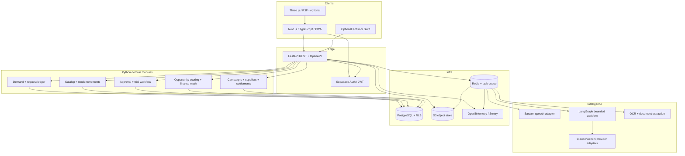

# 03 — LEAP AI system architecture

## 1. Design doctrine

Start as a **modular monolith** with well-defined Python domain modules plus one Next.js application and one background worker. Use events/outbox for asynchronous work. Do not introduce Kafka, Kubernetes or microservices just to appear advanced. Keep module boundaries ready for later extraction when load and team size justify it.

## 2. Logical architecture



## 3. Recommended monorepo layout (to be created by Claude Code)

```text
leap-ai/
├─ CLAUDE.md
├─ .claude/skills/                   # this kit
├─ apps/
│  └─ web/                           # Next.js App Router, Next 16-compatible
│     ├─ app/(auth)/
│     ├─ app/(merchant)/dashboard/
│     ├─ app/(merchant)/demand/
│     ├─ app/(merchant)/opportunities/
│     ├─ app/(merchant)/trials/
│     ├─ app/(merchant)/inventory/
│     ├─ app/(merchant)/suppliers/
│     ├─ app/(merchant)/finance/
│     ├─ app/(merchant)/settings/
│     ├─ components/ui/
│     ├─ components/domain/
│     ├─ lib/api/
│     ├─ lib/auth/
│     └─ tests/
├─ services/
│  ├─ api/
│  │  ├─ app/main.py
│  │  ├─ app/api/v1/
│  │  ├─ app/core/{config,auth,logging}.py
│  │  ├─ app/domains/{identity,demand,catalog,inventory,opportunities,trials,suppliers,campaigns,finance,reconciliation}/
│  │  ├─ app/adapters/{paytm,sarvam,llm,storage,notifications}/
│  │  ├─ app/models/
│  │  ├─ app/schemas/
│  │  ├─ alembic/
│  │  └─ tests/
│  └─ worker/                         # tasks: voice/OCR, imports, recalculations
├─ packages/
│  ├─ contracts/                      # versioned OpenAPI-generated TS client/types
│  └─ design-tokens/
├─ infra/
│  ├─ docker-compose.yml
│  ├─ db/migrations/
│  ├─ cloud/
│  └─ github/workflows/
├─ assets/
│  └─ 3d/                             # Blender-produced glTF optional
└─ docs/                              # this kit
```

## 4. Request boundaries and trust zones

- Browser carries only public config and session token; never `service_role`, provider secrets, webhook signing secrets or model API keys.
- Next.js uses authenticated server layer; FastAPI independently validates JWT signature, issuer, audience and store membership. Never trust a plain store_id submitted by client.
- Postgres enforces tenant scope; even admins use scoped, audited access. Avoid universal service role in normal request paths.
- Storage objects use per-store path, content-type/size validation, signed time-limited reads and retention cleanup.
- AI adapters receive minimized relevant data and untrusted content as data, not system instructions.
- AI agents cannot directly commit financial ledger mutations; deterministic services validate state transitions.

## 5. Synchronous vs asynchronous

**Synchronous:** auth/roles, catalog CRUD, request text entry, opportunity retrieval, approval, idempotent stock movement, trial outcome recording.

**Asynchronous:** speech transcription, image OCR, bulk CSV parsing, supplier comparison, forecast recomputation, large export, alerts, model evaluation. Enqueue jobs with typed status (`queued`, `running`, `needs_review`, `done`, `failed`) and retry/backoff. Expose polling/SSE where useful; avoid tying 30s cloud functions to long jobs.

## 6. Idempotency and event consistency

- Mutating POST endpoints accept `Idempotency-Key` scoped by `(tenant, action)` for safe retry.
- Every database transaction writes both business state and `outbox_events` record.
- Worker publishes exactly-once **effect** with at-least-once delivery semantics via deduplication; do not claim the queue itself is exactly once.
- Ledger rows immutable; corrections recorded as compensating movements.
- UI optimistically updates only reversible local state; authoritative financial writes re-fetch server confirmation.

## 7. Domain interfaces

**Demand module** owns request capture, human confirmation, demand normalization and duplicate suggestions. It does not order stock.

**Inventory module** owns catalog, available qty, reserved qty, lot expiry and movement ledger. It does not produce LLM finance prose.

**Decision module** owns deterministic scoring, margin modeling, forecast baselines and recommendation provenance. It never executes purchase actions.

**Workflow module** owns approval/rejection/cancellation, guarded transitions and experiment tracking.

**Connectors** normalize provider objects into internal events; external API-specific schema cannot leak into domain model.

## 8. Data schema and access

Refer to `04_DATA_MODEL_AND_EVENTS.md` for detailed table map. Use UUID identifiers, `tenant_id/store_id`, UTC timestamps, integer money paise or Decimal numeric precision consistently, soft-delete only where policy requires, and audit trails. Prefer `NUMERIC(18,4)` for finance amounts and explicit INR currency, or integer paise for payments; ensure conversions are tested.

## 9. Search, BI and models

- SQL+indexes for core queries. For fuzzy demand aliases use trigram or normalized lookup; add pgvector when evaluation shows a need, not just to advertise vector DB.
- Polars runs aggregation on batch data, while SQL handles daily serving views/materialized views.
- Baseline demand forecast: moving average / seasonal naive, backtested against ETS/gradient model. Confidence intervals and sparse-data abstention.
- No shared embedding index without store-scope filter; embedding provenance and deletion must follow source data deletion.

## 10. Web experience technical design

- App Router for routing, layouts, streaming. Default Server Components, Client Components for audio recorder/charts/3D and dynamic interaction.
- Use generated API types from FastAPI OpenAPI; no duplicated ad-hoc interfaces.
- Server-side session checks and per-operation authorization; Server Actions are not assumed private simply by being server-side.
- Accessible `aria` labels, focus states, skeletons, error boundaries, responsive table patterns, locale-aware formatting, and mobile bottom action bar.

## 11. 3D and native boundaries

- Blender builds efficient product/store glTF assets; React Three Fiber loads lazy scene only on optional screen with 2D fallback.
- Unity is a **separate** experience driven by the same read-only API; never the system-of-record for finance.
- Android Jetpack Compose / SwiftUI clients share OpenAPI contracts; no parallel hand-written business rules.

## 12. Deployment topology

- Web: Vercel or managed Node hosting.
- API/worker: persistent container host supporting long-running Python services; separate scaling for worker queue.
- Database: managed Postgres/Supabase; Redis managed.
- Object storage: authenticated signed S3-compatible service.
- DNS/TLS, encrypted backups, trusted domains, staging+production separation, no production test fixtures.
- Observability includes request/trace IDs, tenant-safe logs, p95 metrics, job failure rate, STT latency, AI per-feature cost and unauthorized-access alerts.

## 13. Decision record requirements

For each non-trivial architectural change, create ADR with context, alternatives, decision, reversibility and operational consequences. Important current ADRs:

- ADR-001: modular monolith before microservices.
- ADR-002: Supabase Auth + Postgres tenant RLS, validated by FastAPI.
- ADR-003: deterministic finance service, AI only for interpretation/proposals.
- ADR-004: Paytm connector feature flag until permissioned access.
- ADR-005: PWA first; 3D and native optional.
